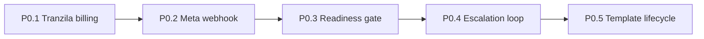

# MOKED P0 — close gaps to sell-only mode

## Confirmed baseline (repo today)

- [payments.ts](src/lib/integrations/payments.ts) fabricates `pay.moked.local` URLs; Wave D drops `externalId` even though `payment_external_id` exists in SQL.
- [billing.ts](src/lib/product/billing.ts) `startCheckout()` only sets `pending` + synthetic id; no hosted URL. Billing webhook has HMAC; [payments/webhook](src/app/api/payments/webhook/route.ts) trusts the body.
- Meta webhook parses inbound `messages` only; soft-opens if `META_APP_SECRET` unset; `webhook_events` unused; no delivery timestamps.
- Engine gates takeover / inactive subscription / bot cap only — no readiness. Escalation emits events then dies. Templates are a reply `type` label, not Meta Message Templates.
- No unit-test runner — only [scripts/smoke-wave-a.mjs](scripts/smoke-wave-a.mjs). **Decision:** add `tsx` + Node `node:test` as `npm run test`, keep smoke green after every PR.

## Delivery shape

Five sequential PRs off `main` (`cursor/<name>-3841`). After each: `npm run lint`, `npm run build`, `npm run smoke:wave-a`, new unit tests green. Demo path (`MOKED_PROVIDER_MODE=demo`) stays the sell path. No real Meta/Tranzila calls in tests — mock `fetch` / use `DemoPspClient`.

P1 (dunning, coexistence, cost transparency) is out of scope after these five.

---

## PR1 — P0.1 Real Tranzila billing

**New:** [src/lib/integrations/tranzila.ts](src/lib/integrations/tranzila.ts), [src/lib/integrations/psp-webhook.ts](src/lib/integrations/psp-webhook.ts)

- `PspClient` interface exactly as in the brief (`createHostedCharge`, `chargeToken`, `verifyWebhook`).
- `DemoPspClient`: deterministic `hostedUrl` / tokens, no network; `verifyWebhook` = HMAC-SHA256 of raw body vs `x-moked-signature` using `TRANZILA_WEBHOOK_SECRET` (same fail-closed pattern as today's billing HMAC).
- `TranzilaClient` (live): env-only `TRANZILA_API_URL`, `TRANZILA_TERMINAL`, `TRANZILA_API_KEY` (+ secret for V2 HMAC headers). Hosted charge = Handshake V2 `POST …/v2/handshake/create` then build hosted/iframe URL from env base; token charge uses Token Module endpoint from env. Notify verify: shared-secret / `response_hash` per Tranzila notify docs; reject otherwise.
- `getPsp()` selects by `MOKED_PROVIDER_MODE` (`demo` default).

**Wire:**

- `createPaymentLink()` → `getPsp().createHostedCharge()` in live; keep current `moked.local` demo URLs in demo; return `{ url, externalId, provider }`.
- Persist `payment.externalId` through [types.ts](src/lib/types.ts), [db.ts](src/lib/store/db.ts), [file-db.ts](src/lib/store/file-db.ts), [waves/payment.ts](src/lib/processes/waves/payment.ts).
- `startCheckout()`: live → hosted charge, persist `externalId`/`provider`, return redirect URL; demo → `pending` + `billingConnected: false` (honest UI). Update [billing/checkout/route.ts](src/app/api/billing/checkout/route.ts) to return `checkoutUrl` / `externalId`.
- Both webhooks call `psp-webhook` verify → 401 if bad; look up by `externalId` only (never trust body `tenantId`/`conversationId`); idempotent insert into `webhook_events`; on active call existing `applyBillingEvent` + `lockAvailableNumber` + emit `subscription.activated`.
- Align Supabase: migration copying subscription columns from [db/product.sql](db/product.sql) if missing from migrations; `.env.example` for new vars; retire `BILLING_WEBHOOK_SECRET` reads in favor of `TRANZILA_WEBHOOK_SECRET` (single secret path).

**Tests:** `src/lib/integrations/*.test.ts` — demo + mocked live charge; unsigned webhook 401; replay no-op.

---

## PR2 — P0.2 Meta webhook hardening

- Extend [MetaWebhookSchema](src/lib/whatsapp/webhook.ts) with `statuses[]` and `message_template_status_update`.
- Migration `*_message_status.sql`: `messages.delivered_at|read_at|failed_at|error_code`; mirror [db/schema.sql](db/schema.sql).
- Route: after signature check, claim idempotency key (`entry.id` + message/status id) in `webhook_events` (unique PK skip); return 200; process statuses → update message timestamps; emit `message.failed` once; template updates → tenant template row `approved|rejected` + `template.rejected` (stubs a minimal template row until P0.5 if needed, or store on a JSON field and migrate in P0.5 — **concrete:** add thin `templates` table early here so status updates have a home; P0.5 fills submit/seed).
- Live: `verifyMetaSignature` fail-closed when `MOKED_PROVIDER_MODE=live`; explicit `MOKED_META_SIGNATURE_BYPASS=1` for local only (remove soft-open-on-missing-secret).

**Tests:** fixtures for delivered/failed/template-rejected; duplicate fixture → one row + one event.

---

## PR3 — P0.3 Readiness gate

**New:** [src/lib/product/readiness.ts](src/lib/product/readiness.ts), `GET /api/tenants/readiness` (owner session), `POST /api/admin/tenants/[id]/go-live` (`requireSuperadminContext`).

Checks per brief. **Demo relaxed set** (documented in-file): skip live Graph `token_valid` / `webhook_subscribed` / `display_name_approved`; still require `whatsapp_connected`, `subscription_active` (demo can activate via signed webhook), `bot_instructions_approved`, and `templates_approved` when processes need them. Live runs full Graph checks with tenant token.

- Cache report 5 minutes (in-memory Map keyed by tenantId); bust on go-live.
- [engine.ts](src/lib/processes/engine.ts): before process run, if any `blocking` check fails → return `tenant_not_ready`, emit `tenant.blocked`.
- Dashboard + onboarding: show checklist with failing step + fix link; never green "live" when `ready === false`.

**Tests:** table-driven per failing check; engine refuses in demo and live modes.

---

## PR4 — P0.4 Escalation loop

- Migration: `conversations.escalation` jsonb + index `(tenant_id, status)`.
- Escalate once per conversation on: `human.decision_needed`, low confidence, "person" ask, payment/quote exception. Shape `{ reason, at, notifiedAt, resolvedAt, channel, attempts }`.
- Notify via highest available channel: owner WhatsApp template outside 24h window, else email stub/log; respect `tenant.hours` except payment issues (immediate). Re-notify once after 30m if unresolved; cap 2.
- Dashboard inbox: Hebrew queue **"ממתין לאדם"** by wait time; one-click takeover → `human_takeover` + pause automation; `resolve` clears escalation and unpauses.

Reuse/extend existing `notifyOwner` in engine rather than a parallel notifier.

**Tests:** fixture escalates once, notifies ≤2, resolve unpauses.

---

## PR5 — P0.5 Template lifecycle

- Finish `templates` table (if thin table landed in P0.2): `tenantId, name, language, category, components, status, metaId, rejectionReason, submittedAt, approvedAt`; `he` + `utility` only.
- `POST /api/templates/submit` → Graph create (mocked in demo), store `metaId` + `pending`.
- `GET /api/templates` → refresh pending statuses.
- Seed constants: booking confirmation + T-24h reminder with documented `{{1}}` placeholders; one-click submit from UI.
- Readiness `templates_approved` blocks go-live when enabled processes need unapproved templates.
- Channel path: reminders/retention actually send Meta templates when approved (demo keeps text fallback labelled demo).

**Tests:** submit → `pending`; refresh → `approved`/`rejected` with reason.

---

## Repo hygiene (every PR)

- Update [STATUS.md](STATUS.md): what shipped, what still needs Meta/Tranzila dashboard credentials.
- `.env.example` for: `MOKED_PROVIDER_MODE`, `TRANZILA_*`, `META_APP_SECRET`, `META_TEMPLATE_SUBMIT_ENABLED`, `MOKED_META_SIGNATURE_BYPASS`.
- Secrets server-side only.

## Definition of done (whole brief)

Signup → live WhatsApp reply with zero manual code steps; dashboard refuses "live" until blocking checks pass; Tranzila path works in live (credentials from owner dashboards) and is clearly demo in demo; failed message / rejected template / stuck conversation each visible + notified; lint/build/smoke green.