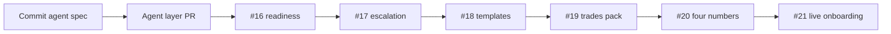

---
todos:
  - id: commit-agent-spec
    status: in_progress
    content: Commit docs/MOKED-AGENT-SPEC-EN.md unchanged; treat as SoT for agent behavior
  - id: agent-layer
    content: 'Agent layer PR: types, migration, classify, runAgentTurn, grounding, eval green'
    status: pending
  - id: pr-16-readiness
    content: '#16 readiness with demo rule set; no network in unit tests; never fail-closed on missing Meta in demo'
    status: pending
  - id: pr-17-escalation
    content: '#17 escalation loop as v1'
    status: pending
  - id: pr-18-templates
    content: '#18 Hebrew utility templates as v1'
    status: pending
  - id: pr-19-trades
    content: '#19 trades knowledge pack + slot-based visit scheduler (no calendar required)'
    status: pending
  - id: pr-20-four-numbers
    content: '#20 one-screen dashboard — inquiries, <1min answers, visits, booked value'
    status: pending
  - id: pr-21-live-onboarding
    content: '#21 onboarding ends with live שלום test on the new ad number'
    status: pending
  - id: park-14-payments
    content: 'Park #14 Wave D behind MOKED_ENABLE_CUSTOMER_PAYMENTS=false; hide UI'
    status: pending
  - id: saas-billing-later
    content: Post go-live — setup/monthly/annual from env; first 10 invoiced manually
    status: pending
name: Agent layer beachhead
overview: 'Trades beachhead v1: lock pricing/positioning, ship agent layer from docs/MOKED-AGENT-SPEC-EN.md, then #16–#18 with demo-safe readiness, then #19–#21. Park customer payments (#14). Manual SaaS billing for first ten.'
isProject: false
---
# MOKED v1 — trades beachhead (locked)

## Owner decisions (locked)

| Decision | Choice |
|---|---|
| Beachhead | Trades / home services only (renovation, HVAC, electrical, plumbing, handyman). Clinics later. |
| Positioning | New dedicated WhatsApp number per client for ads / landing / quote form. Existing number untouched. **No Coexistence in v1.** Remove flows that assume migrating the main number. |
| Pricing | Setup **₪690** + monthly **₪299** + annual **₪2,990**. First ten: setup waived for testimonial + reference. Env only: `MOKED_SETUP_FEE_ILS=690`, `MOKED_SUBSCRIPTION_ILS=299`, `MOKED_ANNUAL_ILS=2990`. Never hardcode. |

## Agent-layer source of truth

- File: [`docs/MOKED-AGENT-SPEC-EN.md`](docs/MOKED-AGENT-SPEC-EN.md) (owner adding to repo).
- **First action on execute:** commit that file **unchanged**, then read it fully.
- Behavior rules, confidence thresholds, and eval set come only from that doc. If it conflicts with existing code → **stop and ask**, do not choose silently.

## v1 scope cut (hard)

In: agent layer, readiness, escalation, templates, trades pack, four-number screen, live onboarding test, ad-number positioning.

Out: customer payment collection, per-tenant card/PSP onboarding, product catalog, broadcasts, multi-user inbox, English UI, dashboards beyond one screen. Payment/catalog code stays in repo, **hidden**.

## PR order (confirm before #19)

1. **Commit** `docs/MOKED-AGENT-SPEC-EN.md` unchanged.
2. **Agent layer PR** (new) — `src/lib/agent/*`, migration `tenant_knowledge` + `conversations.agent`, wire `runAgentTurn` before `runActiveProcess` in [engine.ts](src/lib/processes/engine.ts), `npm run eval:agent` green, `docs/AGENT.md`. Demo works with **no LLM key / no cost**. Spec is SoT.
3. **[#16](https://github.com/YoniLevy10/Moked/pull/16) readiness** — v1. **Hard constraint:** demo rule set passes with no real Meta number and no live token; unit tests must **not** require network. Live gets the strict set. Fail-closed on missing number in demo would block #17/#18 and kill demo — forbidden.
4. **[#17](https://github.com/YoniLevy10/Moked/pull/17) escalation** — v1 as already scoped.
5. **[#18](https://github.com/YoniLevy10/Moked/pull/18) templates** — v1 as already scoped.
6. **#19 trades knowledge pack** — seeded `tenant_knowledge` + process preset for the four trades; slot-based visit scheduler for owners with no calendar. Trades-only assets (knowledge, questions, ads, landing copy).
7. **#20 four-number dashboard** — one screen only: inquiries received, answered under a minute, visits scheduled, booked value.
8. **#21 live onboarding** — ends with prospect messaging the **new** number from his phone; agent answers with his business details. No main-number migration flow.

### Parked / later (not before go-live)

- **[#14](https://github.com/YoniLevy10/Moked/pull/14):** park end-customer Wave D payment links + webhook behind `MOKED_ENABLE_CUSTOMER_PAYMENTS=false`. No UI implies it exists. Hide, do not delete. (#15 Meta webhook hardening can land with #16 stack if still needed for statuses/idempotency; not a beachhead product surface.)
- **MOKED SaaS subscription billing** (setup/monthly/annual checkout): separate from #14; **not a v1 blocker**. First ten customers invoiced manually. Ship after go-live using the env fee vars above.

## Constraints that do not change

- Demo mode works with no LLM key and no cost.
- `pricing_items` is the only price source.
- Deterministic engine keeps ownership of booking, quote, and payment steps.
- Every new business event is registered in [outcomes.ts](src/lib/outcomes.ts).
- Vertical-specific assets target **trades only**.

## Await

Owner confirmation of this PR order before any work on #19 (and before execute starts the agent-layer PR).
