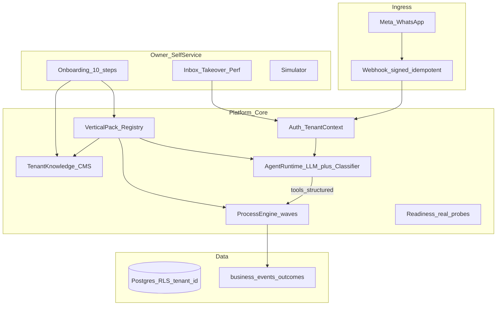

# Moked — תוכנית פלטפורמת AI WhatsApp Business Agent

**מבוסס על:** `origin/main` @ `7aa232a`, ביקורות [`internal/platform-e2e-gap-map.md`](/cursor/stores/self/internal/platform-e2e-gap-map.md) + [`internal/platform-critical-failures.md`](/cursor/stores/self/internal/platform-critical-failures.md).  
**החלטות נעולות:** Multi-Tenant + Multi-Vertical מהיום · Trades ראשון · אנכי תורים שני אחרי לקוחות משלמים · Self-Service מלא + Managed כמסלול אופציונלי · LLM להבנה + Process Engine לביצוע · Wave D נשאר דגל־כבוי עד P2 · אין rewrite · אין Multi-Agent · אין קליניקות רפואיות.

**הגדרת הצלחה:** לקוח Trades משלם מפעיל סוכן חי ב־WhatsApp בלי פעולת מפתח נסתרת; אחרי P1 בעל עסק עובר 10 שלבי Self-Service לבד.

---

## 1. מיפוי קיים מול חסר (מסלול הפעלה אמיתי)

| יכולת | מצב בפועל | פער |
|---|---|---|
| Multi-tenant + auth | יש `TenantSchema`, session, onboarding 3 שלבים | אין staff roles; superadmin `getActiveTenant` מחזיר `tenants[0]` ב־Postgres |
| WhatsApp demo/live | Embedded Signup + demo connect | חתימה soft-open כשלא live; statuses לא נפרסים; idempotency לא בנתיב |
| Agent | `runAgentTurn` = classifier בלבד (`void hasLlmKey`) | אין LLM אמיתי; ידע/regex תלויי trades |
| Processes A–C | intake→qual→booking→reminders/quote | slots סינתטיים; Wave D stub + webhook **ללא** auth |
| Four numbers + demo badge | חי על dashboard | — |
| Readiness | demo-relaxed / live Graph | `webhook_subscribed` = false-green (phone GET ≠ subscribed_apps) |
| Billing SaaS | env fees + landing ₪299 | checkout stub; לקוח ראשון = חשבונית ידנית עד P1 |
| Vertical packs | [`src/lib/trades/pack.ts`](src/lib/trades/pack.ts) קשיח | אין ממשק pack גנרי; אנכי תורים לא ממומש |

**לא לספור כקיים רק כי יש קובץ:** LLM path, payment webhook מאובטח, webhook statuses, isolation על `GET /api/conversations?id=`, זמינות אמיתית, Self-Service מלא.

---

## 2. Target Architecture

**עקרונות:**
- **Vertical Pack** = ממשק יחיד: knowledge templates, classifier vocab, workflow presets, slot/appointment policy, default bot policy, eval fixtures.
- Trades = pack ראשון; Appointments = pack שני; אותו `runAgentTurn` + `engine.ts`.
- LLM מחזיר structured decision (intent, slots, reply draft, tool calls); **מחירים/זמינות/הנחות** רק מ־tools שקוראים ל־`pricing_items` / availability API — אסור טקסט חופשי על מחיר.
- Process Engine נשאר בעלים של booking/quote/payment/reminders.
- Managed Onboarding = Superadmin ממלא את אותם APIs של Self-Service — לא מסלול קוד נפרד.

**שינויי ליבה מתוכננים (מינימום):**
- `src/lib/verticals/types.ts` + `registry.ts` — ממשק pack; העברת trades ל־`verticals/trades/`.
- `src/lib/agent/llm.ts` — קריאת מודל + Zod structured output מאחורי אותם שערי grounding ב־[`policy.ts`](src/lib/agent/policy.ts) / [`knowledge.ts`](src/lib/agent/knowledge.ts).
- השלמת [`#15`](https://github.com/YoniLevy10/Moked/pull/15) ל־webhook statuses + `claimWebhookEvent` (טבלת `webhook_events` כבר קיימת).

---

## 3. השלמת מנוע הסוכן

1. חיבור LLM אמיתי ב־`runAgentTurn` כש־`OPENAI_API_KEY` (או ספק נבחר) קיים; בלי מפתח — classifier הקיים (demo ללא עלות נשמר).
2. Structured output + tools: `lookup_price`, `propose_slots`, `start_process`, `escalate`, `answer_from_knowledge`.
3. Fail-closed: אין מחיר ב־catalog → escalate / “אבדוק ואחזור”; אסור invent.
4. Conversation state ב־`conversations.agent` (כבר קיים) + הרחבת schema לפי הצורך.
5. Eval: שמירת 60 goldens + הרחבה ל־LLM path (invented prices = 0 חובה); מדדי production נפרדים מ־golden escalate rate.
6. **לא** Multi-Agent; **לא** ביטול classifier (fallback + בדיקות יחידה זולות).

---

## 4. Full Self-Service Onboarding (10 שלבים)

הרחבת [`src/app/onboarding/page.tsx`](src/app/onboarding/page.tsx) + APIs קיימים:

1. הרשמה · 2. בחירת vertical (trades עכשיו; appointments אפור עד P2) · 3. פרטי עסק / שירותים / מחירים / שעות · 4. מדיניות סוכן · 5. כללי הסלמה · 6. Meta Embedded Signup · 7. סימולטור · 8. Readiness אמיתי · 9. Go-live · 10. עריכה חוזרת בלי מפתח.

ברירות מחדל חכמות מ־Vertical Pack.  
Owner console: שיחות, takeover, knowledge/prices editor, ביצועים (4 מספרים), אוטומציות/תזכורות.

Managed = Superadmin על אותם endpoints.

---

## 5. Trades → Production (לקוח משלם ראשון)

- תיקון כל פריטי **P0** למטה.
- Meta env מאומת (כבר הוגדרו fees בפרודקשן).
- Number pool + live שלום test אמיתי מטלפון.
- תבניות HE utility מאושרות ב־Meta לפני reminders.
- זמינות: שעות פעילות + קיבולת יומית ב־DB (לא מחולל פיקטיבי בלבד); Google Calendar OAuth = P2.
- חיוב לקוח ראשון: חשבונית ידנית (₪690 אופציונלי לוויתור תמורת המלצה / ₪299 חודשי) לפי העדפה קיימת; checkout כרטיס = P1.

---

## 6. Vertical שני — עסקים מבוססי תורים

**רק אחרי:** ≥1 לקוח Trades משלם יציב + P0 ירוק + pack interface ב־main.  
Pack חדש: יופי / מאמן / שירותי פגישות — אותם waves עם מודל “appointment” במקום “site visit”; בלי קליניקות רפואיות.  
אין אפליקציה נפרדת.

---

## 7. תמחור וכלכלת יחידה (נעול כברירת מחדל לתוכנית)

| | |
|---|---|
| מחיר ללקוח | הקמה ₪690 + חודשי ₪299 (שנתי ₪2,990) — מ־env |
| עלות משתנה/שיחה (הערכה) | WhatsApp ~₪0.1–0.4 + LLM ~₪0.05–0.2 |
| חבילה v1 | עד 1,000 outbound/חודש (`DEFAULT_OUTBOUND_CAP`) |
| תמיכה | Self-Service + escalation לבעלים; תמיכת Moked ב־Managed בלבד |
| הקמה ממוצעת יעד | Self-Service &lt; 30 דק׳; Managed &lt; 2 שעות |
| רכישה | P0 ידני → P1 checkout באתר |
| רווח גולמי יעד | &gt;70% בממוצע &lt;400 שיחות/חודש; התראת soft-cap ב־80% מהמכסה |

נוסחת מעקב ב־superadmin: `(MRR - WA - LLM - support_alloc) / MRR` לכל טננט.

---

## 8. Security · Reliability · Observability

| כשל | חומרה | תיקון | קבלה |
|---|---|---|---|
| `POST /api/payments/webhook` ללא חתימה | Critical | HMAC/fail-closed; כיבוי כשהדגל off; ביטול `"שילמתי"`→paid | POST לא חתום לא משנה `payment.status` |
| WhatsApp soft-open unsigned | Critical | חתימה חובה כשיש tenant live | unsigned → 401 |
| אין idempotency inbound | High | `#15` + טיפול unique `meta_message_id` | replay = turn יחיד |
| Statuses נזרקים | High | parse + persist ב־#15 | status לא מפעיל agent |
| IDOR `GET /api/conversations?id=` | Critical | סינון `tenant_id` | טננט אחר → 404 |
| Superadmin active tenant | High | persist בחירת טננט ב־DB | activate משפיע על API |
| Readiness false-green | High | בדיקת `subscribed_apps` אמיתית | לא ready בלי webhook אמיתי |
| בידוד DB | High | אכיפת `tenant_id` בכל query רגיש + בדיקות | suite isolation ירוק |
| Observability | Med | לוגים מבניים: tenant, metaMessageId, agent decision, cost tokens | אפשר לשחזר כשל לקוח |

Retries: outbound WhatsApp עם backoff; inbound תמיד 200 אחרי claim כדי לעצור storm מ־Meta.

---

## 9. Roadmap — P0 / P1 / P2

### P0 — Must לפני לקוח משלם ראשון (Trades Production)

סדר תלויות:

1. **Security freeze:** payments webhook lock + conversation IDOR + signature fail-closed ל־live tenants.
2. **Webhook durability:** rebase/merge [#15](https://github.com/YoniLevy10/Moked/pull/15) — statuses + idempotency בלבד.
3. **Readiness אמיתי** + go-live בלי פעולות נסתרות (רשימת checklist אוטומטית בלבד).
4. **Availability אמיתית ל־Trades:** שעות+קיבולת ב־DB; הסרת “תמיד יש חלון”.
5. **Live Meta E2E** מתועד: connect → inbound → agent → booking → reminder template.
6. **Eval gate:** `npm run eval:agent` ירוק; 0 invented prices; תיקון unexpected escalate אם &gt;3.
7. **Vertical pack interface מינימלי** + העברת trades ל־pack (בלי אנכי שני עדיין) — כדי לא לבנות חוב ארכיטקטוני.
8. **Managed path** מאומת ל־3 לקוחות ראשונים (חשבונית ידנית OK).

**DoD P0:** לקוח Trades חי על מספר ייעודי, משלם (ידני), ארבעה מספרים מנתונים אמיתיים, demo badge רק ב־demo.

### P1 — Must לפני Self-Service רחב

1. Onboarding 10 שלבים + knowledge/policy/escalation editors.
2. Inbox + takeover מלא לבעלים.
3. LLM path מאחורי grounding + cost accounting.
4. SaaS card checkout (השלמת [`#14`](https://github.com/YoniLevy10/Moked/pull/14) ל־**SaaS בלבד**; Wave D נשאר כבוי).
5. שימוש/מכסות + התראות.
6. Observability בסיסי (לקוח / עלות / שגיאות Meta).
7. Isolation test suite + superadmin tenant switch מתוקן.

**DoD P1:** עסק חדש נרשם→חי בלי מפתח; זמן הקמה &lt;30 דק׳ במדידה פנימית.

### P2 — אחרי ולידציה מסחרית

1. Appointments vertical pack.
2. Wave D + PSP אמיתי מאחורי דגל (רק אם לקוחות מבקשים).
3. Google Calendar OAuth.
4. צוות/תפקידים מעבר ל־owner יחיד.
5. אנליטיקת Meta quality / תמחור שיחות מתקדם.

---

## 10. מה לא מפתחים עכשיו

- קליניקות רפואיות / HIPAA-like.
- Multi-Agent / rewrite של process engine.
- Coexistence / מיגרציית מספר קיים.
- Chatbot builder חופשי בלי grounding.
- Broadcast / CRM מלא / multi-channel (SMS/web) כ־GA.
- אנגלית כ־UI ראשי (HE נשאר).
- Wave D ללקוחות קצה לפני ביקוש מוכח.
- אנכי שני לפני לקוח Trades משלם יציב.

---

## סדר ביצוע מומלץ אחרי אישור התוכנית

Security freeze → #15 → Readiness/Availability → Live E2E Trades → Pack interface → (לקוחות) → P1 Self-Service+LLM+SaaS checkout → P2 Appointments.

תוכנית זו נשמרת גם כמסמך פרויקט ב־[`docs/whatsapp-agent-platform-plan.md`](/cursor/stores/self/docs/whatsapp-agent-platform-plan.md) לאחר האישור (באישור הנוכחי מוגשת דרך Plan UI).
